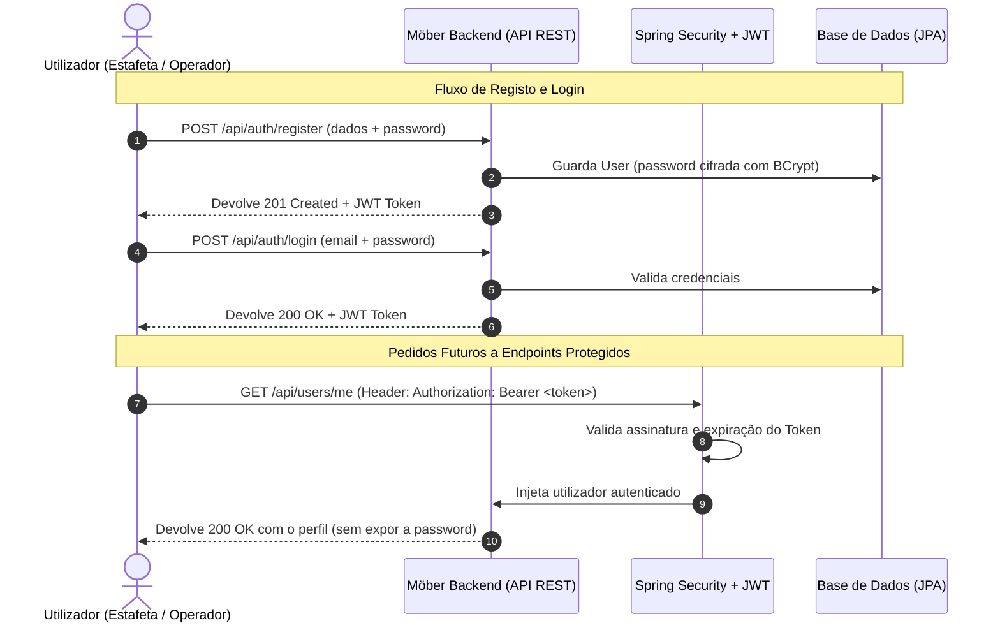

# SCRUM-38: Gestão de Utilizadores, Autenticação e Controlo de Acessos (RBAC)

Este documento resume de forma simples e de alto nível o que foi implementado na branch `SCRUM-38-user-management-and-auth` (em relação à branch `dev`), explicando a lógica de funcionamento e como este módulo se integra no projeto global da **Möber**.

---

## 1. Contexto e Ligação ao Projeto Möber

A plataforma **Möber** é um sistema de micromobilidade partilhada focado em entregas urbanas sustentáveis. O ecossistema envolve múltiplos intervenientes e componentes integrados:
* **Estafetas (`ROLE_COURIER`):** Reservam e desbloqueiam veículos para realizar entregas na cidade.
* **Operadores / Técnicos (`ROLE_OPERATOR`):** Monitorizam o estado da frota, recolhem veículos com bateria fraca ou reparam avarias reportadas pelo simulador.
* **Administradores (`ROLE_ADMIN`):** Gerem o sistema, visualizam métricas e supervisionam a operação.
* **Simulador de Frota (IoT / MQTT):** Emite telemetria dos veículos e executa ordens de bloqueio/desbloqueio.

### O papel desta história (`SCRUM-38`):
A autenticação e controlo de acessos é a **porta de entrada e o alicerce de segurança de todo o backend**. Sem este módulo:
1. Não seria possível saber que estafeta está a requisitar ou a libertar uma bicicleta/trotinete.
2. Qualquer utilizador anónimo conseguiria aceder a dados confidenciais ou invocar ações restritas.
3. Os restantes módulos (Gestão de Viagens, Faturação, Manutenção) não teriam forma de associar eventos a utilizadores reais.

---

## 2. Como Funciona a Solução (Visão de Alto Nível)

Adotou-se uma arquitetura **Stateless baseada em JSON Web Tokens (JWT)**, que é o padrão moderno para APIs REST e microserviços.

### O ciclo de vida da segurança:
1. **Registo:** O utilizador submete nome, email, password e perfil desejado. A password nunca é guardada em texto limpo — é cifrada com **BCrypt** antes de ir para a base de dados.
2. **Login:** O utilizador apresenta as credenciais. Se forem válidas, o servidor gera e assina digitalmente um token **JWT** contendo a identidade e o perfil do utilizador.
3. **Pedidos seguintes:** O cliente guarda o token e envia-o no cabeçalho HTTP (`Authorization: Bearer <token>`) em qualquer pedido futuro. O servidor valida o token matematicamente em milissegundos sem precisar de guardar sessões na memória.
4. **Controlo de Acessos (RBAC):**
   * `/api/auth/**` e `/api/status`: Públicos (qualquer pessoa acede).
   * `/api/users/me`: Protegido (requer token válido de qualquer perfil ativo).
   * `/api/users/**`: Administrativo (o Spring Security bloqueia automaticamente com `403 Forbidden` se quem chamar não for `ROLE_ADMIN`).

---

## 3. Estrutura dos Componentes Criados

Toda a solução foi simplificada e mantida enxuta, dividida nas seguintes camadas lógicas:

| Camada | Ficheiros Principais | Responsabilidade |
| :--- | :--- | :--- |
| **Domínio & Dados** | `User.java` `Role.java` `UserRepository.java` | Tabela de utilizadores (`id`, `name`, `email`, `password`, `role`) e interface de acesso à base de dados com Spring Data JPA. |
| **Segurança & JWT** | `SecurityConfig.java` `JwtService.java` `JwtAuthenticationFilter.java` | Configura as regras do Spring Security, gera/valida os tokens JWT e interceta os pedidos HTTP para autenticar quem chama. |
| **Lógica de Negócio** | `AuthService.java` | Regras de registo (verificar email duplicado, cifrar password), login (conferir password) e consulta de perfil. |
| **API REST** | `AuthController.java` `DTOs` (`RegisterRequest`, `LoginRequest`, etc.) | Expõe os endpoints HTTP (`/register`, `/login`, `/me`) e valida os dados de entrada com Jakarta Validation. |
| **Tratamento de Erros** | `GlobalExceptionHandler.java` | Converte erros técnicos em respostas JSON limpas e padronizadas com os códigos HTTP corretos (400, 401, 403, 404, 409). |

---

## 4. Garantia de Qualidade e Testes (Alinhamento com TQS)

A implementação segue os requisitos da unidade curricular de TQS:

1. **Abordagem BDD (Behavior-Driven Development):**
   * O comportamento esperado foi previamente formalizado no ficheiro [SCRUM-38-user-auth.feature](file:///home/margarida/Desktop/TQS-project/M-ber/docs/specs/SCRUM-38-user-auth.feature) em linguagem Gherkin (`Given / When / Then`), alinhado com o feedback da equipa.
2. **Testes Unitários (Mockito):**
   * [AuthServiceTest.java](file:///home/margarida/Desktop/TQS-project/M-ber/backend/src/test/java/pt/ua/tqs/mober/service/AuthServiceTest.java): Testa a lógica de negócio isolada com mocks (registo com email duplicado, password errada, etc.).
   * [JwtServiceTest.java](file:///home/margarida/Desktop/TQS-project/M-ber/backend/src/test/java/pt/ua/tqs/mober/security/JwtServiceTest.java): Valida a criação e verificação da assinatura dos tokens.
3. **Testes de Integração (MockMvc + Spring Security):**
   * [AuthControllerIntegrationTest.java](file:///home/margarida/Desktop/TQS-project/M-ber/backend/src/test/java/pt/ua/tqs/mober/controller/AuthControllerIntegrationTest.java): Simula pedidos HTTP reais contra o Spring Boot completo e a base de dados em memória H2, garantindo que os filtros de segurança, o retorno dos tokens e as restrições de RBAC (ex: 403 Forbidden para não-administradores) funcionam em conjunto.
