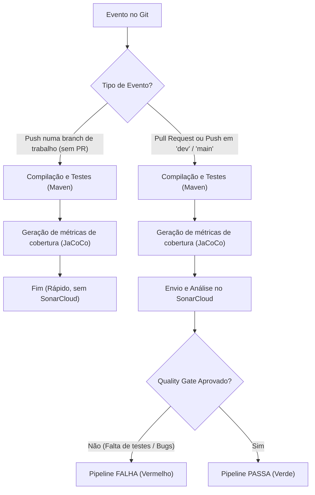

# Regras de CI e Quality Gate Bloqueante

Este documento descreve o fluxo de Integração Contínua (CI), quando é que cada etapa é executada, o seu propósito e as regras de proteção que garantem a qualidade do código antes da integração.

---

## 1. Fluxo Principal (*Main Flow*)

O pipeline de backend corre automaticamente no GitHub Actions e divide-se em dois níveis de verificação conforme o contexto:

---

## 2. Quando Acontece e Para Quê?

### A. Em qualquer branch pessoal (Trabalho diário)
* **Quando:** Sempre que é feito um `push` numa branch de feature/tarefa.
* **O que faz:** Compila o código Java e corre todos os testes unitários e de integração, gerando o relatório de cobertura do JaCoCo.
* **Para quê:** Dá feedback imediato ao programador se algum teste quebrou, sem perder tempo a enviar análises pesadas para a cloud enquanto o trabalho ainda está em curso.

### B. Em Pull Requests e nas branches principais (`dev` e `main`)
* **Quando:** 
  1. Sempre que um **Pull Request** é aberto ou atualizado com novos commits.
  2. Sempre que é feito merge definitivo para as branches **`dev`** ou **`main`**.
* **O que faz:**
  * Corre os testes e gera a cobertura (JaCoCo).
  * Autentica-se e envia o código e as métricas para o **SonarCloud**.
  * **Aguarda pelo resultado:** O pipeline fica à espera da avaliação das métricas de qualidade.
* **Para quê:** Avaliar se o novo código cumpre os padrões de qualidade (ausência de bugs, vulnerabilidades e cobertura mínima de testes) antes de ser integrado.

---

## 3. Como Funciona o Bloqueio (*Blocking Gate*)

Para garantir que código sem qualidade **nunca** entra na base de código partilhada, existem duas barreiras obrigatórias:

### 1. Bloqueio no Pipeline (CI)
* O scanner do SonarCloud está instruído para aguardar pelo veredito final (`sonar.qualitygate.wait=true`).
* Se o código violar as regras do Quality Gate (ex: código novo sem testes ou duplicações excessivas), o SonarCloud reprova a análise e o job do GitHub Actions **falha imediatamente (fica vermelho)**.

### 2. Bloqueio no Repositório (Regras de Proteção no GitHub)
As branches **`dev`** e **`main`** têm regras de proteção ativas nas definições do GitHub:
* **Proibido Push Direto:** Ninguém pode enviar código diretamente para a `dev` ou `main`; todas as alterações têm obrigatoriamente de vir através de um Pull Request.
* **Checks Obrigatórios:** O Pull Request só pode receber *merge* se todos os checks do pipeline passarem com sucesso (verde).
* **Sem Exceções (*No Bypass*):** A opção de contornar regras está desativada, garantindo que nem mesmo os administradores podem forçar a integração de código se o Quality Gate estiver chumbado.
